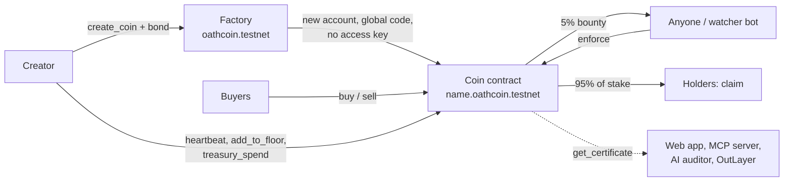

<p align="center">
  
</p>

<p align="center">
  <a href="https://oath-near.vercel.app"></a>
  <a href="https://github.com/opeblow/oath/actions/workflows/ci.yml"></a>
  <a href="LICENSE"></a>
  <a href="https://testnet.nearblocks.io/address/oathcoin.testnet"></a>
  
  
  
  
</p>

<p align="center">
  <a href="https://oath-near.vercel.app"><b>Open the app</b></a> &nbsp;|&nbsp;
  <a href="#try-it-in-five-minutes-no-wallet-no-funds">Try it in 5 minutes</a> &nbsp;|&nbsp;
  <a href="#how-we-used-near">How we used NEAR</a> &nbsp;|&nbsp;
  <a href="#use-it-from-an-ai-agent">AI agents</a> &nbsp;|&nbsp;
  <a href="#project-structure">Code map</a>
</p>

---

## A memecoin is a promise. OATH makes it a contract.

Every memecoin launch comes with promises: *"liquidity is locked"*, *"the team won't dump"*, *"we ship every week"*. They live in a tweet, so breaking them costs nothing, and buyers find out at the bottom of the chart.

**OATH is a memecoin launchpad on NEAR where every promise is a contract rule.**

- What code can prevent, it **prevents**. Liquidity has no withdraw method. Creator tokens cannot move before they vest.
- What code cannot prevent, it **prices**. The creator stakes NEAR on each future promise. Miss a deadline and anyone can enforce it: they earn 5% of the stake and holders split the other 95%.
- Nobody holds the keys. Each coin is its own contract account with **zero access keys**, running one published code hash, and the factory that creates them has zero keys too. Not the creator, not us.

> Built at NEAR HACKATHON 2026 for the **Memecoins With Mechanics** track. The mechanic is accountability: a coin whose creator can be fined by its own community, automatically.

<p align="center">
  
</p>

## Contents

1. [Try it in five minutes (no wallet, no funds)](#try-it-in-five-minutes-no-wallet-no-funds)
2. [Try it with a testnet wallet](#try-it-with-a-testnet-wallet)
3. [The oaths](#the-oaths)
4. [How it works](#how-it-works)
5. [How we used NEAR](#how-we-used-near)
6. [Use it from an AI agent](#use-it-from-an-ai-agent)
7. [How OATH fits the track](#how-oath-fits-the-track)
8. [How OATH compares](#how-oath-compares)
9. [What is real and what is not](#what-is-real-and-what-is-not)
10. [Project structure](#project-structure)
11. [Run it locally](#run-it-locally)
12. [Tests](#tests)
13. [Built with](#built-with)
14. [Hackathon submission](#hackathon-submission)

## Try it in five minutes (no wallet, no funds)

Everything below reads live from NEAR testnet. Two demo coins exist: one whose creator kept their promise, and one whose creator broke it.

| Do | See |
| --- | --- |
| Open the [registry](https://oath-near.vercel.app/coins) | Every coin, with oath status, bond at stake and locked liquidity |
| Open [Kept Word ($KEPT)](https://oath-near.vercel.app/coin/kept.oathcoin.testnet), tab **Oaths** | Oath 6 *"Add 1 NEAR to the floor"* reads **Kept**. The creator added the NEAR and took back the stake |
| Open [First Oath ($FIRST)](https://oath-near.vercel.app/coin/first.oathcoin.testnet), tab **Oaths** | Oath 6 *"Show up every 1 day"* reads **Broken**. The creator missed the update due 3 Nov 2026 23:05 UTC |
| Same coin, tab **Activity** | The `Enforce` event by `oathcode.testnet` (our watcher bot) and the holder's `Claim` |
| Same coin, top facts | **Paid to holders** shows the 0.95 NEAR the broken promise cost the creator |
| Any coin, tab **Verify** | Zero access keys, the global code hash, factory registration, and a solvency sum, all read directly from RPC |
| Any coin, tab **Audit** | A grade from A to D with every finding. $KEPT gets an A; $FIRST gets a D for its broken oath |
| Any coin, tab **Ask the auditor**, click a question | A plain-English answer from a model running in a TEE on NEAR AI Cloud, with four verification checks listed under it |
| The [Watch and earn](https://oath-near.vercel.app/watch) page | Every oath in force across all coins, sorted by deadline, and any you can enforce right now |
| Run the command below | The certificate of $KEPT straight from the chain, no website involved |

```bash
curl -s https://rpc.testnet.fastnear.com -H 'Content-Type: application/json' -d '{
  "jsonrpc":"2.0","id":"oath","method":"query",
  "params":{"request_type":"call_function","finality":"optimistic",
    "account_id":"kept.oathcoin.testnet","method_name":"get_certificate","args_base64":"e30="}}' \
  | jq -r '.result.result | implode | fromjson | .bonded'
# -> [{ "kind": "floor_top_up", "status": "kept", "reclaimed": true, ... }]

near account list-keys kept.oathcoin.testnet network-config testnet now
# -> no keys. Nobody can sign for this coin.

near account list-keys oathcoin.testnet network-config testnet now
# -> no keys. The factory is locked too: nobody can change how coins are made.
```

## Try it with a testnet wallet

Get free testnet NEAR from the [faucet](https://near-faucet.io) and connect Meteor, HOT or another NEAR wallet on the site.

| Do | See |
| --- | --- |
| On a coin, **Buy** 0.2 NEAR | A live quote (tokens, fee, slippage guard), then your balance under **Your position** |
| Switch to **Sell**, press **Max** | NEAR comes back from the locked reserve |
| Open **Launch**, fill the four steps | The certificate preview redraws as you type. One transaction creates the coin, deposits the bond and seals the oaths. You land on your certificate as the wax seal stamps |
| As the creator, use the **Creator desk** | Post a heartbeat, add to the floor, spend the treasury. Try an undeclared recipient: the contract refuses |
| When an oath breaks, press **Enforce** on **Watch and earn** | You receive 5% of the stake. Holders see a **Claim** button on the coin |

## The oaths

| Sealed oaths (impossible to break) | How the contract enforces it |
| --- | --- |
| **Liquidity is locked** | Buys and sells run on a bonding curve inside the coin contract. There is no withdraw method. NEAR leaves only through `sell` |
| **Creator tokens vest** | At most 10% of supply. Every transfer and sell checks the vesting lock (cliff, then linear) |
| **Snipers are capped** | During the launch window no wallet may exceed a set share of supply, and the creator cannot buy at all |
| **The fee is fixed** | Set at launch, capped at 2%, paid into the coin's treasury |
| **The treasury has rules** | Spends go only to accounts declared at launch, within a per-period limit, each with a public memo |

| Bonded oaths (expensive to break) | Broken when | What happens |
| --- | --- | --- |
| **Show up every N days** | The creator misses an on-chain `heartbeat` | Anyone calls `enforce`: 5% of the stake to them, 95% to holders by balance |
| **Add X NEAR to the floor** | The deposit is short at the deadline | Same. A kept oath lets the creator `reclaim_stake` |

The certificate shows facts only: oath statuses, NEAR at stake, keys, code hash, solvency. There is no subjective trust score.

## How it works



1. **Launch.** The factory creates `<name>.oathcoin.testnet`, points it at the published token code (a NEAR global contract), initialises it with the creator's oaths and bond, and adds no key. If initialisation fails, the whole batch rolls back and the deposit is refunded.
2. **Trade.** A constant-product bonding curve with a virtual NEAR reserve. Fees go to the treasury. The contract tracks its books: balance must cover reserve + treasury + bond + unclaimed payouts + storage.
3. **Keep or break.** Statuses are computed from the block clock on every read. `active` turns into `breakable` the moment a deadline passes.
4. **Enforce.** Any account calls `enforce(index)`. The stake splits 5/95, and holder shares are tracked with a reward-per-token accumulator, so a payout costs the same gas for 1 holder or 10,000.
5. **Read anywhere.** One view, `get_certificate`, returns everything. The web app, the MCP server, the AI auditor and the OutLayer auditor all start from it.

## How we used NEAR

| NEAR feature | What OATH does with it | Where | Check it |
| --- | --- | --- | --- |
| **Global contracts** | Every coin runs one published token code by hash, so "same code for every coin" is provable on chain | [`contracts/factory`](contracts/factory/src/lib.rs) uses `use_global_contract` | Verify tab: code hash `DjVgSpu5...` |
| **Keyless sub-accounts** | Each coin is an account with no access key, so nobody can redeploy or drain it | Factory batch: create, transfer, use code, init | `near account list-keys <coin>` is empty |
| **NEP-141 / 145 / 148 / 297** | Standard fungible token, storage registration, metadata, and events (standard `oath`) | [`contracts/token`](contracts/token/src/lib.rs) | Any NEAR wallet shows the token |
| **NEAR AI Cloud (private inference)** | "Ask the auditor" runs `DeepSeek-V4.1-Flash` in a TEE. The server verifies the enclave signature, the request and response hashes, and a fresh attestation report before showing the answer | [`web/api/_lib`](web/api/_lib) | Ask tab: four Pass lines and the enclave key |
| **NEAR OutLayer** | The audit rules compiled to a 151 KB `wasm32-wasip1` program, executed off-chain by OutLayer, with the result recorded in the transaction | [`auditor/`](auditor), [`mcp/src/outlayer.ts`](mcp/src/outlayer.ts) | [$KEPT audit, grade A](https://testnet.nearblocks.io/txns/FyPm12aTefgv2PQxt9LchVkLwiScwEqC59hWp475eZs3) |
| **NEAR Intents (1Click)** | The **Any chain** tab quotes buying a coin with USDC on Base, SOL, BTC and more, using live signed solver quotes | [`web/src/lib/intents.ts`](web/src/lib/intents.ts) | Any chain tab. 1Click is mainnet-only, so this testnet build quotes but does not execute |
| **NEAR Connect** | Wallet selection and signing for all NEAR wallets | [`web/src/lib/wallet.tsx`](web/src/lib/wallet.tsx) | Connect wallet button |
| **Public RPC (FastNEAR)** | Every number on screen is a direct RPC read. There is no indexer and no database | [`web/src/lib/near.ts`](web/src/lib/near.ts) | Network tab in your browser |
| **NEAR Sandbox** | End-to-end tests publish the global code and run the full lifecycle on nearcore 2.14 | [`contracts/sandbox-tests`](contracts/sandbox-tests) | CI job `contracts` |

## Use it from an AI agent

OATH is built to be read by machines. The [`mcp/`](mcp) package is an MCP server any agent can plug in.

| Tool | What it does |
| --- | --- |
| `list_coins` | Registry page |
| `get_coin` | Every oath in plain words with its live status |
| `verify_coin` | Zero keys, published code, registered, solvent: one `trustworthy` flag |
| `audit_coin` | The A to D audit with findings |
| `find_enforceable` | Broken oaths across all coins, with the bounty for each |
| `quote` | Buy or sell quote on the curve |
| `get_holder` | Balance, vesting lock, claimable payouts |
| `get_activity` | Latest on-chain events |
| `enforce_oath` | Enforces a broken oath and collects the bounty (needs a key) |

```bash
cd mcp && npm install && npm run build
```

```json
{ "mcpServers": { "oath": { "command": "node", "args": ["/path/to/oath/mcp/dist/server.js"] } } }
```

Then ask your agent: *"Is kept.oathcoin.testnet safe to buy? Verify and audit it."* or *"Can I enforce any OATH oath right now?"*

**Watcher bot.** It scans every coin and enforces broken oaths for the 5% bounty. It runs every 20 minutes on GitHub Actions ([`watcher.yml`](.github/workflows/watcher.yml)), and it is the bot that enforced the broken oath on $FIRST.

```bash
cp .env.example .env    # NEAR_ACCOUNT_ID and NEAR_PRIVATE_KEY of a testnet account
node --env-file=.env dist/watch.js --interval 60     # or --once, or --dry-run
```

**OutLayer audit of any coin:** `node --env-file=.env dist/outlayer.js kept.oathcoin.testnet`

## How OATH fits the track

The track asks for memecoins where *"the meme does something"*, judged *"on the mechanic, not the chart"*.

| Track asks for | OATH |
| --- | --- |
| A mechanic, not a chart | The coin page leads with oaths and their status. Price is one line in the trade panel |
| Treasuries with rules | Declared recipients, a per-period cap and a public memo, all enforced by the contract |
| Onchain rituals and challenges | The heartbeat is a public ritual the creator must keep. Enforcement is an open challenge anyone can win |
| NEP-141 token mechanics | NEP-141 with vesting checks on every transfer, a launch-window wallet cap, and pro-rata NEAR payouts to holders |
| Reproducible, "do X, see Y" | Every step above works with no wallet. A hosted demo, two live demo coins and CI on every push |
| Answers the skeptics | Memecoins are often called "a series of false promises masking a casino". OATH turns the promises into code and makes breaking one cost the creator |

## How OATH compares

Most memecoin projects add a game on top of the token: hold-to-vote, streaks, crash rounds, hot-potato timers. These are fun, but none of them stop a creator from pulling liquidity, dumping an allocation or disappearing. OATH works one layer down, on whether the creator can be trusted at all. Any of those games can launch as an OATH coin and inherit its guarantees.

| | Typical memecoin launch | Game and ritual coins | **OATH** |
| --- | --- | --- | --- |
| Liquidity can be pulled | Trust the team or a third-party locker | Not addressed | **Impossible: no withdraw method, no keys** |
| Creator allocation | Unrestricted | Not addressed | **Max 10%, vesting checked on every transfer** |
| Launch sniping | Bots win | Not addressed | **Wallet cap; the creator cannot buy** |
| Roadmap promises | A tweet | Not addressed | **Bonded in NEAR, enforceable by anyone** |
| A broken promise | Costs the creator nothing | Costs nothing | **Pays holders 95% of the stake** |
| Verifying all this | Read the docs and hope | Read the code | **One click, live from RPC, or one MCP call** |
| Who can change the code | The deployer key | The deployer key | **Nobody: zero access keys** |
| AI agents | Not supported | Not supported | **MCP server, TEE-verified AI auditor, OutLayer audit** |

## What is real and what is not

We would rather you trust the code than the README.

- **Real and live on testnet:** the factory, both demo coins, trading, vesting, treasury rules, the kept oath, the broken and enforced oath, holder payouts, the AI auditor with TEE verification, and the OutLayer audit transaction.
- **Quote only:** NEAR Intents cross-chain buying. 1Click runs on mainnet only, and this build is testnet. The quotes are real; execution turns on with a mainnet build.
- **Speed bump, not identity:** the launch-window wallet cap can be split across many wallets.
- **Observable promises only:** bonded oaths cover on-chain actions (updates, deposits). "We will list on an exchange" cannot be enforced by a contract, so OATH does not pretend to.
- **The price can still go down.** OATH removes betrayal, not risk.
- **Not audited** by a third party. Testnet only.

## Project structure

```text
oath/
├── contracts/                 Rust smart contracts (near-sdk 5.30)
│   ├── token/                 The coin: curve, sealed + bonded oaths, vesting, treasury, payouts
│   │   └── src/               lib.rs, math.rs (curve), tests.rs (26 unit tests)
│   ├── factory/               Creates keyless coin accounts on the global token code (5 tests)
│   └── sandbox-tests/         End-to-end lifecycle on a local NEAR sandbox (7 tests)
├── web/                       The app: Vite + React + TypeScript
│   ├── api/                   Vercel function: POST /api/ask (NEAR AI Cloud + TEE verification)
│   │   └── _lib/              ask.ts (prompt, rate limit), verify.ts (signature + attestation)
│   ├── public/auditor/        oath-audit.wasm, fetched by OutLayer
│   ├── scripts/               smoke.mjs (every page, desktop + phone), ask-ui.mjs
│   └── src/
│       ├── pages/             Landing, Registry, Launch, Coin, Watch, How, Agents, NotFound
│       ├── components/        Certificate, Seal, guilloche Engraving, Layout
│       │   └── coin/          Trade, Position, Creator desk, Oaths, Verify, Audit, Ask, Activity, Any chain
│       └── lib/               RPC, wallet, oath model, audit rules, Intents client, formatting
├── mcp/                       MCP server, watcher bot, OutLayer runner
│   ├── src/                   server.ts (9 tools), watch.ts, outlayer.ts, oath.ts
│   └── test/                  Tool tests against testnet over stdio
├── auditor/                   The audit as a WASI program for NEAR OutLayer
│   ├── src/main.rs            Reads a certificate on stdin, prints the audit on stdout
│   └── parity/                Fixtures proving it matches the web audit
├── docs/                      Spec, brand, screenshots
└── .github/workflows/ci.yml   Web, MCP, contracts + sandbox, auditor parity
```

## Run it locally

Node 20+. Rust and [`cargo-near`](https://github.com/near/cargo-near) only to build contracts.

```bash
git clone https://github.com/opeblow/oath && cd oath/web
npm install
cp .env.example .env    # optional: NEAR_AI_API_KEY turns on "Ask the auditor"
npm run dev             # http://localhost:5173, reading testnet
```

```bash
cd contracts/token   && cargo near build non-reproducible-wasm
cd ../factory        && cargo near build non-reproducible-wasm
```

## Tests

57 automated tests plus a browser sweep. CI runs all of them on every push.

| Suite | Command | Covers |
| --- | --- | --- |
| Contract unit (31) | `cd contracts && cargo test` | Curve math, oath states, vesting, treasury limits, payouts, factory checks |
| Sandbox end-to-end (7) | `cd contracts/sandbox-tests && npm i && npm test` | Global code publish, keyless launch, trading, sealed rules, kept oath, missed heartbeat, enforce, claim |
| Web (6) | `cd web && npm test` | Audit rules on a real testnet certificate, time formatting |
| MCP (6) | `cd mcp && npm test` | Every tool over stdio against testnet |
| Auditor parity (7) | `cd auditor && cargo build --release && parity/check.sh` | The WASI auditor and the web audit agree on grade and findings |
| Browser smoke | `cd web && node scripts/smoke.mjs` | Every page at 1280px and 390px: content, no console errors, no sideways scroll |

## Built with

No templates or boilerplate were used. All code was written during the hackathon window.

| Area | Libraries and services |
| --- | --- |
| Contracts | `near-sdk` 5.30, `near-contract-standards` 5.30, `uint` |
| Web | React 19, React Router 7, Vite 8, TypeScript, `@hot-labs/near-connect`, `@noble/curves`, `@noble/hashes` |
| MCP and bots | `@modelcontextprotocol/sdk`, `near-api-js` 7, `zod`, `esbuild` |
| Auditor | Rust, `serde`, `serde_json`, target `wasm32-wasip1` |
| Tests | `vitest`, `node:test`, Playwright, `near-sandbox` |
| Services | NEAR testnet, FastNEAR RPC, NEAR AI Cloud, NEAR OutLayer, NEAR Intents 1Click, Vercel |
| Type | Libre Caslon, Libre Franklin, IBM Plex Mono (Google Fonts) |

**AI disclosure.** Much of the code and documentation was written with Claude Code (Anthropic) under the author's direction, then reviewed and tested by the author. The product idea, design direction and decisions are the author's.

## Hackathon submission

- **Event:** NEAR HACKATHON 2026, track `memecoins`.
- **Window:** the first commit is from 3 Nov 2026, so the whole repository was built during the hackathon. There is no pre-hackathon baseline.
- **Submission state:** tag [`hackathon-submission`](https://github.com/opeblow/oath/tree/hackathon-submission). Full diff: [first commit to submission](https://github.com/opeblow/oath/compare/8763cf1...hackathon-submission).
- **Other chains:** none. OATH exists only on NEAR.
- **Hosted demo:** https://oath-near.vercel.app, kept online through judging.

## License

[MIT](LICENSE). See also [Security](SECURITY.md), [Privacy](PRIVACY.md), [Contributing](CONTRIBUTING.md) and the [Code of Conduct](CODE_OF_CONDUCT.md).
