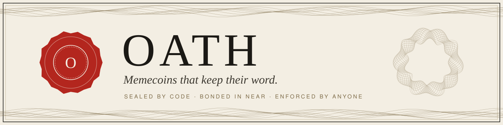
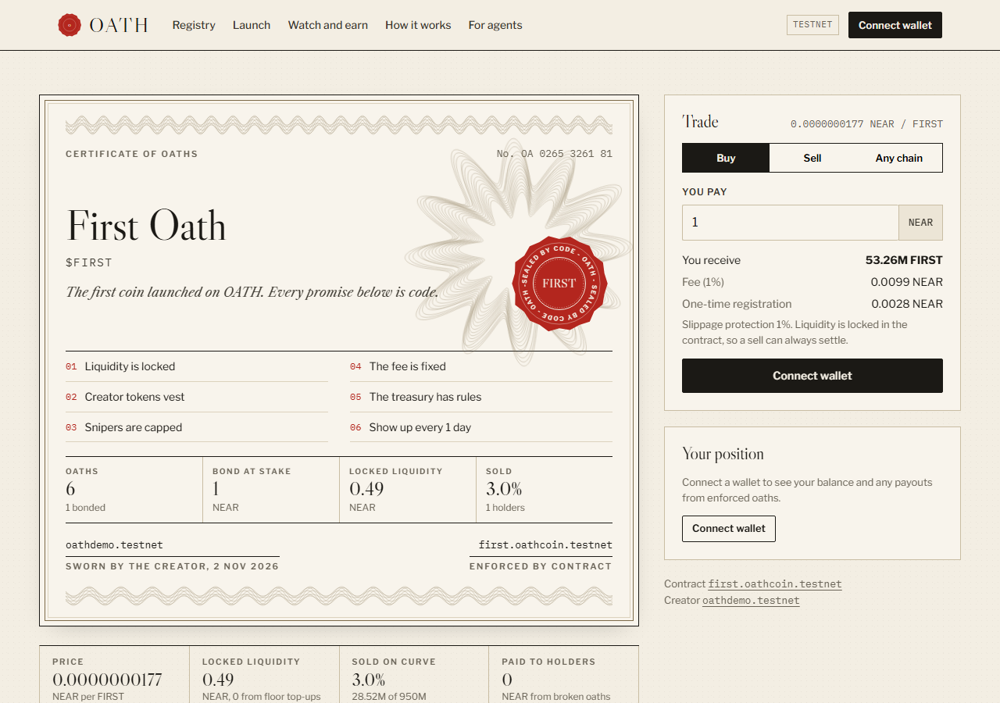
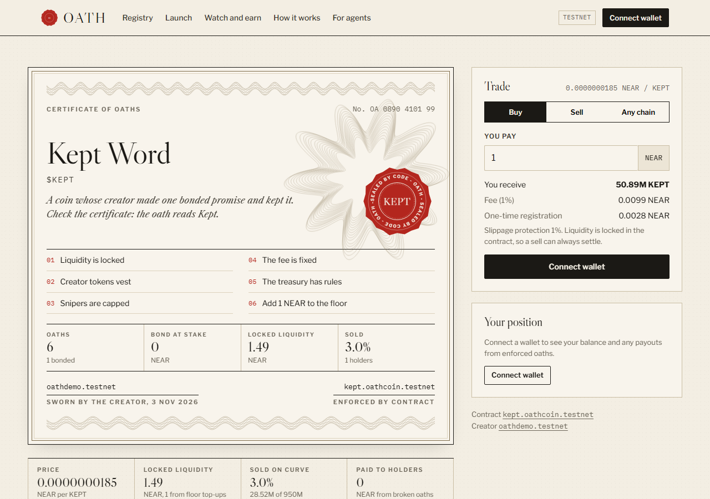
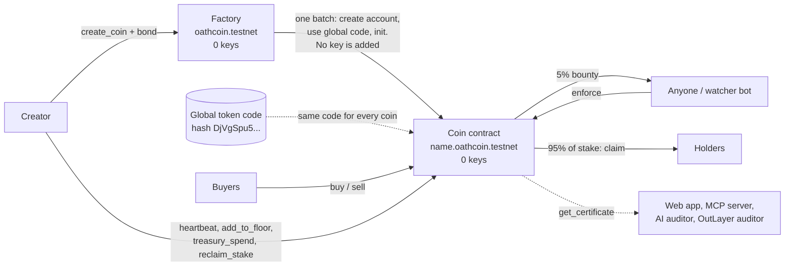
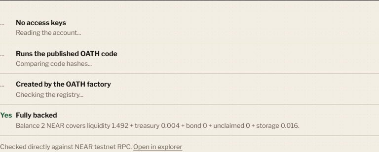

<p align="center">
  
</p>

<p align="center">
  <a href="https://oath-near.vercel.app"></a>
  <a href="https://github.com/opeblow/oath/actions/workflows/ci.yml"></a>
  <a href="LICENSE"></a>
  <a href="https://testnet.nearblocks.io/address/oathcoin.testnet"></a>
  
  <a href="#tests"></a>
  
  
</p>

<p align="center">
  <a href="https://oath-near.vercel.app"><b>Open the app</b></a> &nbsp;|&nbsp;
  <a href="#verify-it-in-five-minutes-no-wallet-no-funds">Verify it in 5 minutes</a> &nbsp;|&nbsp;
  <a href="docs/EVIDENCE.md">Evidence</a> &nbsp;|&nbsp;
  <a href="#how-it-works">Architecture</a> &nbsp;|&nbsp;
  <a href="#tests">Tests</a> &nbsp;|&nbsp;
  <a href="#use-it-from-an-ai-agent">AI agents</a>
</p>

---

## A memecoin is a promise. OATH makes it a contract.

Every memecoin launch comes with promises: *"liquidity is locked"*, *"the team won't dump"*, *"we ship every week"*. They live in a tweet, so breaking them costs nothing, and buyers find out at the bottom of the chart.

**OATH is a memecoin launchpad on NEAR where every promise is a contract rule.**

- What code can prevent, it **prevents**. The liquidity reserve has no withdraw method. The creator's allocation is capped at 10% and cannot move before it vests.
- What code cannot prevent, it **prices**. The creator stakes NEAR on each future promise. Miss a deadline and anyone can enforce it: the enforcer earns 5% of the stake and holders split the other 95%.
- Nobody holds the keys. Each coin is its own contract account with **zero access keys**, running one published code hash. The factory that creates them has zero keys too.

> Built at NEAR HACKATHON 2026 for the **Memecoins With Mechanics** track. The mechanic is accountability: a coin whose creator can be fined by its own community, by anyone, without asking permission.

### It already happened on chain

The creator of [`$FIRST`](https://oath-near.vercel.app/coin/first.oathcoin.testnet) staked 1 NEAR on posting an update every day, and missed the first one. This is what the contract did with the stake:

| | Account | Received | Transaction |
| --- | --- | --- | --- |
| Enforcer (5%) | `oathcode.testnet`, the watcher bot | 0.05 NEAR | [`88bNY37J...`](https://testnet.nearblocks.io/txns/88bNY37JkfkdPLSUHZruLGDWeirLvGASxduNfDxP6zr2) `enforce` |
| Holders (95%) | `oathbuyer.testnet`, the only holder | 0.949999999999999999999999 NEAR | [`4rAZzNT3...`](https://testnet.nearblocks.io/txns/4rAZzNT388pFpAL6CRVCfnRkuBVgPyWzL1nFK82B8Lce) `claim` |
| Liquidity floor | the coin itself | 1 yoctoNEAR of rounding dust | same `enforce` |
| Creator | `oathdemo.testnet` | nothing | excluded by the contract |

The creator of [`$KEPT`](https://oath-near.vercel.app/coin/kept.oathcoin.testnet) staked 1 NEAR on adding 1 NEAR to the floor, [did it](https://testnet.nearblocks.io/txns/4JYKCk6bBR53p8XRMENsvvmo2WTKY5nVx9fMknGZRuKE), and [took the stake back](https://testnet.nearblocks.io/txns/GmC1YE3HkSKFgoaJ8uShXCoQ4ksUSLAwDFdhVpWjSrU6).

Every figure above can be re-read from the chain with the commands in [`docs/EVIDENCE.md`](docs/EVIDENCE.md).

<p align="center">
  
</p>

## Demo video

<p align="center">
  <a href="https://youtu.be/d7Q7BIl0Gd0"></a>
</p>

<p align="center"><a href="https://youtu.be/d7Q7BIl0Gd0"><b>Watch the demo on YouTube</b></a> (2:54)</p>

## Contents

1. [Verify it in five minutes (no wallet, no funds)](#verify-it-in-five-minutes-no-wallet-no-funds)
2. [Try it with a testnet wallet](#try-it-with-a-testnet-wallet)
3. [The oaths](#the-oaths)
4. [What happens to the money](#what-happens-to-the-money)
5. [How it works](#how-it-works)
6. [How OATH compares](#how-oath-compares)
7. [Security and trust assumptions](#security-and-trust-assumptions)
8. [Tests](#tests)
9. [How we used NEAR](#how-we-used-near)
10. [Use it from an AI agent](#use-it-from-an-ai-agent)
11. [How OATH fits the track](#how-oath-fits-the-track)
12. [Limitations and future work](#limitations-and-future-work)
13. [Project structure](#project-structure)
14. [Run it locally](#run-it-locally)
15. [Built with](#built-with)
16. [Hackathon submission](#hackathon-submission)

## Verify it in five minutes (no wallet, no funds)

Everything below reads live from NEAR testnet. Two demo coins exist: one whose creator kept their promise, and one whose creator broke it.

| Minute | Do | See |
| --- | --- | --- |
| 1 | Open [First Oath ($FIRST)](https://oath-near.vercel.app/coin/first.oathcoin.testnet), tab **Oaths** | Oath 6 *"Show up every 1 day"* reads **Broken**. The creator missed the update due 3 Nov 2026 23:05 UTC |
| 1 | Same coin, tab **Activity** | The `Enforce` event by `oathcode.testnet` and the holder's `Claim` |
| 2 | Same coin, top facts | **Paid to holders** shows the 0.95 NEAR the broken promise cost the creator |
| 2 | Open [Kept Word ($KEPT)](https://oath-near.vercel.app/coin/kept.oathcoin.testnet), tab **Oaths** | Oath 6 *"Add 1 NEAR to the floor"* reads **Kept**. The creator added the NEAR and took back the stake |
| 3 | Either coin, tab **Verify** | Zero access keys, the global code hash, factory registration and a solvency sum, all read directly from RPC |
| 3 | Either coin, tab **Audit** | A grade from A to D with every finding. $KEPT gets an A; $FIRST gets a D for its broken oath |
| 4 | Either coin, tab **Ask the auditor**, click a question | A plain-English answer from a model on NEAR AI Cloud, with four verification checks under it |
| 4 | The [Watch and earn](https://oath-near.vercel.app/watch) page and the [registry](https://oath-near.vercel.app/coins) | Every oath in force across all coins, sorted by deadline, and any you can enforce right now |
| 5 | Run the commands below | The same facts with no website involved |

```bash
RPC=https://rpc.testnet.fastnear.com
view() { curl -s $RPC -H 'Content-Type: application/json' -d "{\"jsonrpc\":\"2.0\",\"id\":1,\"method\":\"query\",\"params\":{\"request_type\":\"call_function\",\"finality\":\"final\",\"account_id\":\"$1\",\"method_name\":\"$2\",\"args_base64\":\"e30=\"}}" | jq -r '.result.result | implode | fromjson'; }
keys() { curl -s $RPC -H 'Content-Type: application/json' -d "{\"jsonrpc\":\"2.0\",\"id\":1,\"method\":\"query\",\"params\":{\"request_type\":\"view_access_key_list\",\"finality\":\"final\",\"account_id\":\"$1\"}}" | jq '.result.keys | length'; }

# The broken promise: who enforced it and what holders were paid.
view first.oathcoin.testnet get_certificate | jq '{status: .bonded[0].status, enforced_by: .bonded[0].enforced_by, payouts_distributed}'
# { "status": "broken", "enforced_by": "oathcode.testnet", "payouts_distributed": "949999999999999999999999" }

# The kept promise.
view kept.oathcoin.testnet get_certificate | jq '.bonded[0] | {status, reclaimed}'
# { "status": "kept", "reclaimed": true }

# Nobody can sign for the coins or for the factory.
keys first.oathcoin.testnet; keys kept.oathcoin.testnet; keys oathcoin.testnet
# 0  0  0
```

More commands, every transaction and the code hash check are in [`docs/EVIDENCE.md`](docs/EVIDENCE.md).

## Try it with a testnet wallet

Get free testnet NEAR from the [faucet](https://near-faucet.io) and connect Meteor, Intear or Nightly on the site (all support testnet).

| Do | See |
| --- | --- |
| On a coin, **Buy** 0.2 NEAR | A live quote (tokens, fee, slippage guard), then your balance under **Your position** |
| Switch to **Sell**, press **Max** | NEAR comes back from the locked reserve |
| Open **Launch**, fill the four steps | The certificate preview redraws as you type. One transaction creates the coin, deposits the bond and seals the oaths. You land on your certificate as the wax seal stamps |
| As the creator, use the **Creator desk** | Post a heartbeat, add to the floor, spend the treasury. Try an undeclared recipient: the contract refuses |
| When an oath breaks, press **Enforce** on **Watch and earn** | You receive 5% of the stake. Holders see a **Claim** button on the coin |

<p align="center">
  
</p>

## The oaths

| Sealed oaths (impossible to break) | How the contract enforces it |
| --- | --- |
| **Liquidity is locked** | Buys and sells run on a bonding curve inside the coin contract. There is no withdraw method. NEAR leaves the reserve only through `sell` |
| **Creator tokens vest** | At most 10% of supply. Every transfer and sell by the creator checks the vesting lock (cliff, then linear) |
| **Snipers are capped** | During the launch window no wallet may exceed a set share of supply, and the creator cannot buy at all |
| **The fee is fixed** | Set at launch, capped at 2%, paid into the coin's treasury |
| **The treasury has rules** | Spends go only to accounts declared at launch, within a per-period limit, each with a public memo. The treasury holds fees only; it cannot reach the reserve or the bond |

| Bonded oaths (expensive to break) | Broken when | What happens |
| --- | --- | --- |
| **Show up every N days** | The creator misses an on-chain `heartbeat` | Anyone calls `enforce`: 5% of the stake to them, 95% to holders by balance |
| **Add X NEAR to the floor** | The creator's deposits are short at the deadline | Same. A kept oath lets the creator `reclaim_stake` |

The certificate shows facts only: oath statuses, NEAR at stake, keys, code hash, solvency. There is no subjective trust score.

## What happens to the money

**Launch.** The creator attaches the bond (the sum of all stakes, at least 0.1 NEAR each, up to 4 bonded oaths) plus 0.52 NEAR: 0.5 NEAR funds the coin account's storage and 0.02 NEAR pays for the registry entry. The creator may take up to 10% of supply, vesting. The rest goes on the curve.

**Trading.** A constant-product curve with a virtual NEAR reserve sets the price. Each trade pays a fixed fee (at most 2%) into the coin's treasury. Rounding always favours the pool.

**A broken oath.** `enforce(index)` works only while the oath is breakable, and only once. For a stake `S`:

| Share | Goes to | Detail |
| --- | --- | --- |
| 5% of `S` | The account that called `enforce` | Paid in the same transaction |
| 95% of `S` | Holders, in proportion to balance at that moment | The creator and the curve's unsold tokens are excluded. Each holder calls `claim` |
| Rounding dust | The liquidity floor | A few yoctoNEAR at most. Nothing is lost and nothing is over-paid |

Payouts use a reward-per-token accumulator, so enforcement costs the same gas for 1 holder or 10,000. A holder who sells or transfers after enforcement keeps what they had earned; a buyer who arrives later gets nothing from earlier payouts. If there are no holders at all, the whole 95% goes to the floor.

**A kept oath.** The creator calls `reclaim_stake` and gets the full stake back, once.

**The books.** Every yoctoNEAR in the contract sits in one of four buckets: curve reserve, treasury, locked bond, unclaimed payouts. `get_accounting` reports them, and the contract's balance must cover their sum plus storage. A unit test follows a full lifecycle and checks the total after every step.

## How it works



1. **Launch.** The factory creates `<name>.oathcoin.testnet`, points it at the published token code (a NEAR global contract), initialises it with the creator's oaths and bond, and adds no key. If initialisation fails, the whole batch rolls back and the deposit is refunded.
2. **Trade.** Buys and sells go to the coin contract itself. There is no pool to migrate to and no LP token for anyone to hold.
3. **Keep or break.** Statuses are computed from the block clock on every read. `active` becomes `breakable` the moment a deadline passes. A late heartbeat or a late deposit does not undo it.
4. **Enforce.** Any account calls `enforce(index)`. No vote, no oracle, no admin.
5. **Read anywhere.** One view, `get_certificate`, returns everything. The web app, the MCP server, the AI auditor and the OutLayer auditor all start from it. There is no indexer and no database.

**Contracts.** [`contracts/token`](contracts/token/src/lib.rs) is the coin: NEP-141 with the curve, oaths, vesting, treasury and payouts, and no owner or admin method. [`contracts/factory`](contracts/factory/src/lib.rs) creates coins and keeps the registry; its token code hash is fixed at initialisation and it has no owner method either.

## How OATH compares

This compares approaches, not specific projects. The first two columns describe what is typical for each category; individual projects differ, and we make no claim about any named one. The OATH column is checked by the tests and evidence linked in this README.

| Question | Typical memecoin launch | Game and ritual memecoins | **OATH** |
| --- | --- | --- | --- |
| Can liquidity be withdrawn? | Depends on the team, or on a third-party locker with an expiry | Usually outside the mechanic's scope | **No. The contract has no withdraw method and the account has no keys** |
| Is the creator's allocation restricted? | Set by the team, often unrestricted | Usually outside the mechanic's scope | **Capped at 10%. The vesting lock is checked on every creator transfer and sell** |
| Do promises have a financial cost? | No. A roadmap is a post | The game has rules; the creator's promises about the coin do not | **Yes. Each bonded promise has NEAR staked on it** |
| Who can enforce a broken promise? | Nobody | Nobody | **Any account, by calling `enforce`** |
| Are holders compensated? | No | No | **95% of the stake, claimable pro rata** |
| Can the code's integrity be checked independently? | Requires reading and trusting the deployment | Requires reading and trusting the deployment | **Three RPC reads: zero keys, global code hash, factory registration** |
| Can agents use it? | Rarely | Rarely | **MCP server with 9 tools; an agent can verify, audit and enforce** |

Games and rituals answer *"what does holding this coin let me do?"*. OATH answers a different question: *"what can the creator not do to me?"*. The two are compatible. A game coin could launch as an OATH coin and keep its game.

## Security and trust assumptions

What you do **not** have to trust:

- **The creator.** They hold no key to the coin. Their only powers are four creator methods (`heartbeat`, `add_to_floor`, `treasury_spend`, `reclaim_stake`) and trading under the vesting lock, each bounded by rules fixed at launch.
- **The OATH team.** The factory has zero keys ([deleted here](https://testnet.nearblocks.io/txns/A4nuSsLeQYRDbUW7swhHXwGJBwFXGBfXBk6TyuPmR9AK)). We cannot upgrade coins, pause them, change the fee or touch funds.
- **The website.** Everything it shows is a direct RPC read you can repeat with `curl`.
- **The watcher bot.** It is a convenience. If it stops, anyone else can enforce and earn the bounty.

What you **do** have to trust:

- **The token code itself.** It is open source and tested, but it has not been audited by a third party, and because the coins are keyless a bug cannot be patched in place. That is the cost of immutability.
- **NEAR.** Consensus, the global contract feature and the block timestamp. Deadlines use block time, so they are exact to about a second, not to the nanosecond.
- **For the AI answer only:** NEAR AI Cloud's attestation service, and our server to run the four checks honestly. See [EVIDENCE section 8](docs/EVIDENCE.md#8-tee-verification-of-the-ai-auditor). The AI explains the certificate; it has no authority over any on-chain value.

Known behaviours worth knowing:

- **The wallet cap is a speed bump.** It applies per account during the launch window and can be split across wallets.
- **A stake is the maximum penalty.** A creator who decides a 1 NEAR stake is worth losing can still break the promise. OATH makes that public, permanent and paid to holders; it does not make it impossible.
- **Payouts go to holders at the moment of enforcement.** Someone could buy just before enforcing to take a share. They pay the curve fee both ways, and earlier holders are diluted, not excluded.
- **Reselling creator tokens needs buyers.** A vested creator can sell only into NEAR that buyers put in; the curve never pays out more than it received.
- **Known rounding edge case in the deployed code.** If two oaths on the same coin are enforced and a holder claims only after both, the combined rounding can make the last claim exceed the contract's `unclaimed` counter by 1 yoctoNEAR, and that claim reverts until a later payout tops the counter up. Found by our own sandbox test after submission. No NEAR is lost and the contract stays solvent, but the holder is blocked. Claiming after each enforcement avoids it, and coins with one bonded oath (both demo coins) cannot hit it. The fix is a one-line saturating subtraction; because coins are keyless it ships only with a new code hash.
- **Enforcement needs someone to call it.** A broken oath stays `breakable` forever, including after its term ends, until an account enforces it. The creator cannot reclaim it by waiting.

Report a vulnerability through [SECURITY.md](SECURITY.md).

## Tests

93 automated tests plus a browser sweep. CI runs all of them on every push and pull request ([workflow](.github/workflows/ci.yml), [runs](https://github.com/opeblow/oath/actions/workflows/ci.yml)).

| Suite | Tests | Command | Covers |
| --- | --- | --- | --- |
| Contract unit | 63 | `cd contracts && cargo test` | Curve math, oath states and deadlines, enforcement, payouts and rounding, bond accounting, vesting, treasury, conservation of NEAR, factory checks |
| Sandbox end-to-end | 11 | `cd contracts/sandbox-tests && npm i && npm test` | Real nearcore 2.14: global code publish, keyless launch, trading, sealed rules, kept oath, missed heartbeat, repeated enforcement, two-holder payout, failed-launch rollback, real-balance solvency |
| Web | 6 | `cd web && npm test` | Audit rules on a real testnet certificate, time formatting |
| MCP | 6 | `cd mcp && npm run build && npm test` | Every tool over stdio against testnet |
| Auditor parity | 7 | `cd auditor && cargo build --release && parity/check.sh` | The WASI auditor and the web audit agree on grade and findings |
| Browser smoke | - | `cd web && node scripts/smoke.mjs` | Every page at 1280px and 390px: content, no console errors, no sideways scroll |

The properties the contract tests pin down:

| Property | How it is tested |
| --- | --- |
| An oath is enforced once and only once | Second `enforce` fails in unit and sandbox tests; a kept oath can never be enforced |
| 5% / 95% split | Exact bounty asserted; holder claims summed against the pool |
| No NEAR is created or lost | `bounty + paid to holders + dust to floor == stake`, asserted exactly; a lifecycle test checks the books after every step |
| Holders are paid by balance, once | Three holders with different balances; second `claim` fails; the creator's `claim` fails |
| Deadlines are strict | Still alive exactly on the deadline; breakable one second later; late heartbeats and late deposits do not rescue it |
| Vesting cannot be bypassed | Lock is full to the cliff, half at the midpoint, zero at the end; moving one unit more than vested fails |
| The treasury cannot reach other funds | Spending more than the treasury holds fails even when the contract holds more; recipient, cap, memo and caller are each checked |
| Kept bonds return once | Reclaim before kept, after broken, twice, or by a non-creator all fail |
| The real balance covers the books | Sandbox test compares each coin's actual account balance with its reported liabilities and storage |

Unit tests use near-sdk's mocked VM with a simulated clock. Sandbox tests run a real node and wait out real 60 second deadlines. The test-to-property map is in [EVIDENCE section 9](docs/EVIDENCE.md#9-tests-and-ci).

## How we used NEAR

| NEAR feature | What OATH does with it | Where | Check it |
| --- | --- | --- | --- |
| **Global contracts** | Every coin runs one published token code by hash, so "same code for every coin" is provable on chain | [`contracts/factory`](contracts/factory/src/lib.rs) uses `use_global_contract` | Verify tab: code hash `DjVgSpu5...` |
| **Keyless sub-accounts** | Each coin is an account with no access key, so nobody can redeploy or drain it | Factory batch: create, transfer, use code, init | `near account list-keys <coin>` is empty |
| **NEP-141 / 145 / 148 / 297** | Standard fungible token, storage registration, metadata, and events (standard `oath`) | [`contracts/token`](contracts/token/src/lib.rs) | Any NEAR wallet shows the token |
| **NEAR AI Cloud (private inference)** | "Ask the auditor" runs `DeepSeek-V4.1-Flash` in a TEE. The server verifies the enclave signature, the request and response hashes, and a fresh attestation report before showing the answer | [`web/api/_lib`](web/api/_lib) | Ask tab: four Pass lines and the enclave key |
| **NEAR OutLayer** | The audit rules compiled to a 151 KB `wasm32-wasip1` program, executed off-chain by OutLayer, with the result recorded in the transaction | [`auditor/`](auditor), [`mcp/src/outlayer.ts`](mcp/src/outlayer.ts) | [$KEPT audit, grade A](https://testnet.nearblocks.io/txns/FyPm12aTefgv2PQxt9LchVkLwiScwEqC59hWp475eZs3) |
| **NEAR Intents (1Click)** | The **Any chain** tab quotes buying a coin with USDC on Base, SOL, BTC and more, using live signed solver quotes | [`web/src/lib/intents.ts`](web/src/lib/intents.ts) | Any chain tab. 1Click is mainnet-only, so this testnet build quotes but does not execute |
| **NEAR Connect** | Wallet selection and signing for all NEAR wallets | [`web/src/lib/wallet.tsx`](web/src/lib/wallet.tsx) | Connect wallet button |
| **Public RPC (FastNEAR)** | Every number on screen is a direct RPC read. There is no indexer and no database | [`web/src/lib/near.ts`](web/src/lib/near.ts) | Network tab in your browser |
| **NEAR Sandbox** | End-to-end tests publish the global code and run the full lifecycle on nearcore 2.14 | [`contracts/sandbox-tests`](contracts/sandbox-tests) | CI job `contracts` |

## Use it from an AI agent

The mechanic comes first; this layer makes it reachable. An agent can read a certificate, verify a coin and collect a bounty with the same guarantees a person gets.

The [`mcp/`](mcp) package is an MCP server any agent can plug in.

| Tool | What it does |
| --- | --- |
| `list_coins` | Registry page |
| `get_coin` | Every oath in plain words with its live status |
| `verify_coin` | Zero keys, published code, registered, solvent: one `trustworthy` flag |
| `audit_coin` | The A to D audit with findings |
| `find_enforceable` | Broken oaths across all coins, with the bounty for each |
| `quote` | Buy or sell quote on the curve |
| `get_holder` | Balance, vesting lock, claimable payouts |
| `get_activity` | Latest on-chain events |
| `enforce_oath` | Enforces a broken oath and collects the bounty (needs a key) |

```bash
cd mcp && npm install && npm run build
```

```json
{ "mcpServers": { "oath": { "command": "node", "args": ["/path/to/oath/mcp/dist/server.js"] } } }
```

Then ask your agent: *"Is kept.oathcoin.testnet safe to buy? Verify and audit it."* or *"Can I enforce any OATH oath right now?"*

**Watcher bot.** It scans every coin and enforces broken oaths for the 5% bounty. It runs every 20 minutes on GitHub Actions ([`watcher.yml`](.github/workflows/watcher.yml)), and it is the bot that enforced the broken oath on $FIRST.

```bash
cp .env.example .env    # NEAR_ACCOUNT_ID and NEAR_PRIVATE_KEY of a testnet account
node --env-file=.env dist/watch.js --interval 60     # or --once, or --dry-run
```

**AI auditor.** The A to D grade comes from fixed rules, not from a model. "Ask the auditor" adds a plain-English explanation from a model on NEAR AI Cloud, shown only with its four verification results.

**OutLayer audit of any coin:** `node --env-file=.env dist/outlayer.js kept.oathcoin.testnet`

<p align="center">
  
</p>

## How OATH fits the track

The track asks for memecoins where *"the meme does something"*, judged *"on the mechanic, not the chart"*.

| Track asks for | OATH |
| --- | --- |
| A mechanic, not a chart | The coin page leads with oaths and their status. Price is one line in the trade panel |
| Treasuries with rules | Declared recipients, a per-period cap and a public memo, all enforced by the contract |
| Onchain rituals and challenges | The heartbeat is a public ritual the creator must keep. Enforcement is an open challenge anyone can win |
| NEP-141 token mechanics | NEP-141 with vesting checks on every transfer, a launch-window wallet cap, and pro-rata NEAR payouts to holders |
| Reproducible, "do X, see Y" | Every step above works with no wallet. A hosted demo, two live demo coins and CI on every push |
| Answers the skeptics | Memecoins are often called "a series of false promises masking a casino". OATH turns the promises into code and makes breaking one cost the creator |

## Limitations and future work

We would rather you trust the code than the README.

- **Testnet only, not audited.** No mainnet deployment and no third-party audit yet. Both come before real funds.
- **Two demo coins, both ours.** `$KEPT` and `$FIRST` were created by project accounts to show both outcomes. They are demonstrations, not adoption.
- **Two kinds of bonded oath.** Heartbeats and floor top-ups, because a contract can observe them. "We will list on an exchange" cannot be checked on chain, so OATH does not pretend to enforce it. Holder-judged promises need an arbitration design and are future work.
- **NEAR Intents is quote only.** 1Click runs on mainnet only. The quotes are real; execution turns on with a mainnet build.
- **No upgrades, by design.** Coins and the factory are keyless. A fix means publishing new code and a new factory; existing coins stay as they are.
- **The certificate keeps the last 64 events.** Older activity remains on chain as NEP-297 events but is not returned by `get_activity`.
- **The price can still go down.** OATH removes betrayal, not risk.

Next: a third-party audit, mainnet with live Intents buys, more observable oath kinds (buyback schedules, burn schedules), and automatic OutLayer audits at launch.

## Project structure

```text
oath/
├── contracts/                 Rust smart contracts (near-sdk 5.30)
│   ├── token/                 The coin: curve, sealed + bonded oaths, vesting, treasury, payouts
│   │   └── src/               lib.rs, math.rs (curve), tests.rs (58 unit tests with math.rs)
│   ├── factory/               Creates keyless coin accounts on the global token code (5 tests)
│   └── sandbox-tests/         End-to-end lifecycle on a local NEAR sandbox (11 tests)
├── web/                       The app: Vite + React + TypeScript
│   ├── api/                   Vercel function: POST /api/ask (NEAR AI Cloud + TEE verification)
│   │   └── _lib/              ask.ts (prompt, rate limit), verify.ts (signature + attestation)
│   ├── public/auditor/        oath-audit.wasm, fetched by OutLayer
│   ├── scripts/               smoke.mjs (every page, desktop + phone), ask-ui.mjs, demo-record.mjs
│   └── src/
│       ├── pages/             Landing, Registry, Launch, Coin, Watch, How, Agents, NotFound
│       ├── components/        Certificate, Seal, guilloche Engraving, Layout
│       │   └── coin/          Trade, Position, Creator desk, Oaths, Verify, Audit, Ask, Activity, Any chain
│       └── lib/               RPC, wallet, oath model, audit rules, Intents client, formatting
├── mcp/                       MCP server, watcher bot, OutLayer runner
│   ├── src/                   server.ts (9 tools), watch.ts, outlayer.ts, oath.ts
│   └── test/                  Tool tests against testnet over stdio
├── auditor/                   The audit as a WASI program for NEAR OutLayer
│   ├── src/main.rs            Reads a certificate on stdin, prints the audit on stdout
│   └── parity/                Fixtures proving it matches the web audit
├── docs/                      EVIDENCE.md, SPEC.md, brand, screenshots
└── .github/workflows/         ci.yml (web, MCP, contracts + sandbox, auditor), watcher.yml
```

## Run it locally

Node 20+. Rust and [`cargo-near`](https://github.com/near/cargo-near) only to build contracts.

```bash
git clone https://github.com/opeblow/oath && cd oath/web
npm install
cp .env.example .env    # optional: NEAR_AI_API_KEY turns on "Ask the auditor"
npm run dev             # http://localhost:5173, reading testnet
```

```bash
cd contracts/token   && cargo near build non-reproducible-wasm
cd ../factory        && cargo near build non-reproducible-wasm
```

To deploy your own instance: publish the token wasm as a global contract, deploy the factory, call `new` with the token's code hash, then delete the factory's key. The sandbox test's `before` block in [`oath.test.mjs`](contracts/sandbox-tests/test/oath.test.mjs) does exactly this and is the reference. The MCP server and the web API read the factory from `OATH_FACTORY_ID`.

## Built with

No templates or boilerplate were used. All code was written during the hackathon window.

| Area | Libraries and services |
| --- | --- |
| Contracts | `near-sdk` 5.30, `near-contract-standards` 5.30, `uint` |
| Web | React 19, React Router 7, Vite 8, TypeScript, `@hot-labs/near-connect`, `@noble/curves`, `@noble/hashes` |
| MCP and bots | `@modelcontextprotocol/sdk`, `near-api-js` 7, `zod`, `esbuild` |
| Auditor | Rust, `serde`, `serde_json`, target `wasm32-wasip1` |
| Tests | `vitest`, `node:test`, Playwright, `near-sandbox` |
| Services | NEAR testnet, FastNEAR RPC, NEAR AI Cloud, NEAR OutLayer, NEAR Intents 1Click, Vercel |
| Type | Libre Caslon, Libre Franklin, IBM Plex Mono (Google Fonts) |

**AI disclosure.** Much of the code and documentation was written with Claude Code (Anthropic) under the author's direction, then reviewed and tested by the author. The product idea, design direction and decisions are the author's.

## Hackathon submission

- **Event:** NEAR HACKATHON 2026, track `memecoins`.
- **Window:** the first commit is from 3 Nov 2026, so the whole repository was built during the hackathon. There is no pre-hackathon baseline.
- **Submission state:** tag [`hackathon-submission`](https://github.com/opeblow/oath/tree/hackathon-submission). Full diff: [first commit to submission](https://github.com/opeblow/oath/compare/8763cf1...hackathon-submission). Commits after the tag add documentation, tests and the demo video script; the deployed contracts are keyless and unchanged.
- **Other chains:** none. OATH exists only on NEAR.
- **Hosted demo:** https://oath-near.vercel.app, kept online through judging.

## License

[MIT](LICENSE). See also [Security](SECURITY.md), [Privacy](PRIVACY.md), [Contributing](CONTRIBUTING.md) and the [Code of Conduct](CODE_OF_CONDUCT.md).
